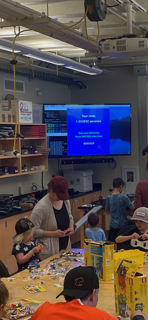
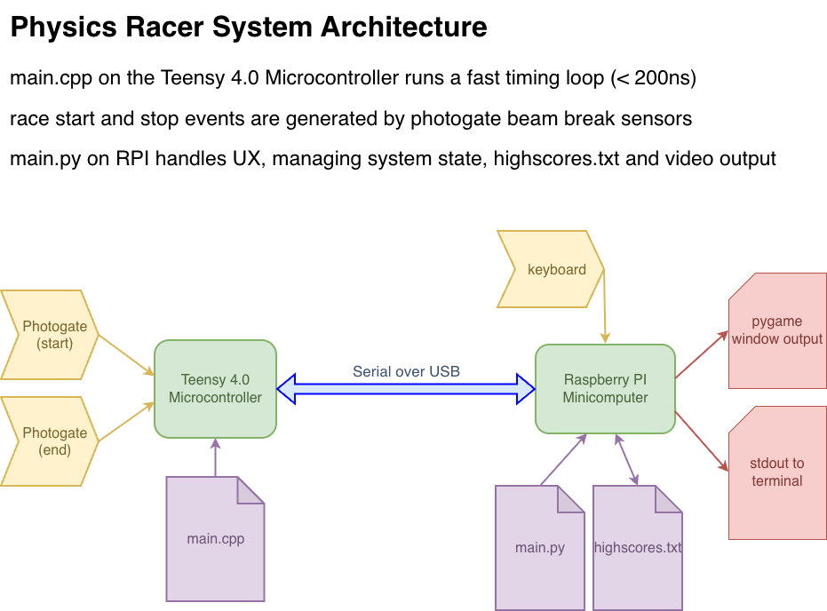

# Physics Racer

LEGO race timing infrastructure

## About the Project

This project was created for Family STEM Day at [Monterey Peninsula College](https://www.mpc.edu/). Designed as a fun activity for LEGO and racing fans of all ages to participate in, it features microsecond timing accuracy and a video-game like interface for logging and displaying race timing results. Participants construct a vehicle from LEGO and race it down the ramp, with race completion times automatically measured and recorded.

## System Overview

The track itself is an [Aluminum Dynamics Track](https://www.pasco.com/products/lab-apparatus/mechanics/carts-and-tracks/aluminum-dynamics-track-2-2-m) (2.2m long), inclined at roughly 25 degrees from horizontal. Starting and finish lines are implemented with [IR Beambreak Sensors](https://www.adafruit.com/product/2168) sensed by a [Teensy 4.1 microcontroller](https://www.pjrc.com/store/teensy41.html) (600 MHz Cortex-M7). The Teensy is dedicated almost entirely to timing the race start and stop conditions, allowing for a high degree of timing precision. Program execution has been instrumented and tested to loop in under 200 ns, so the resulting timings are reliable to microsecond accuracy.

Race results are reported to a Raspberry Pi minicomputer over a USB connection. Race times are then logged, along with user-entered nicknames, in the file highscores.txt. After recording a timing, the fastest times in race history are then displayed. The Python program [rpi/main.py](main.py) uses the [PyGame library](https://www.pygame.org/docs/) for handling video output, as well as reporting program status and execution results to STDOUT where they can be observed in a terminal.

